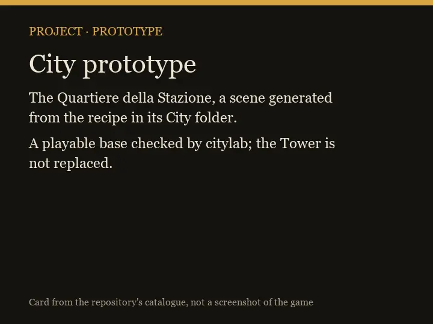

# City prototype

The city prototype is the first project built on the production suite beyond the hotel. It is the station district, a playable base that is generated as its own scene, `Citta.unity`, from the recipe `citta.json`. The Tower is not replaced. [docs/engineering/city-prototype.md](../../docs/engineering/city-prototype.md) keeps the commands, the results and the work still open.

## What it is

- A recipe, `citta.json`, from which Blender makes the models and Unity the scene.
- Four buildings that can be entered, three stalls on the road, and a wave hall to try the wave cycle in.
- A lab, `tools/citylab.py`, which checks the measures of the recipe and writes a preview of the streets, the doors and the spawns.

The city reuses the production suite: its checks run in the [studio engine](../pipeline/studio-engine.md), and the [labs](../pipeline/labs.md) it shares with the packages are the same kind of test.

## Related

- [Studio engine](../pipeline/studio-engine.md): the engine that builds the city as a job.
- [The Unity game](unity-game.md): the project the city sits in.
- [Wave cycle](../cycles/wave-cycle.md): the cycle its hall uses.
