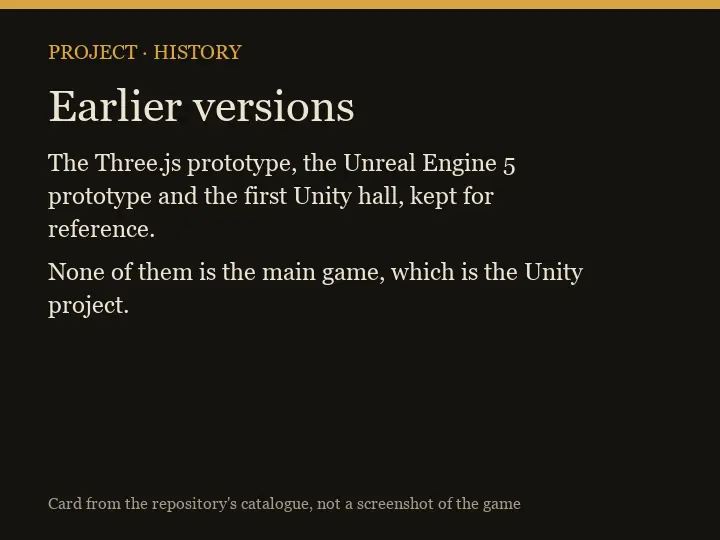

# Earlier versions

Before the Unity game, the same idea, a hotel that watches its guests, was tried in three other ways. [docs/history/legacy-versions.md](../../docs/history/legacy-versions.md) keeps how to run each one and what it included.

- **The Three.js prototype.** A page in the browser, started with a local server, with the first controls and the first rooms. It is the oldest version.
- **The Unreal Engine 5 prototype.** A playable first-person prototype in Unreal, built by scripts.
- **The first Unity hall.** The classic hall of the hotel, built by `HotelBuilder`. It is still in the project as `Hotel.unity`, but it is outside the build; the game is now the Tower and its modes.

The [Unreal prototype](unreal-prototype.md) of the later engineering work is a different test: one room of the Unity game rebuilt in Unreal, not a new game.

## Related

- [The Unity game](unity-game.md): the version that the earlier ones led to.
- [Unreal prototype](unreal-prototype.md): the later test of one room in two engines.
- [Survival redesign](zombies-redesign.md): the change of rhythm that came after the first Unity versions.
