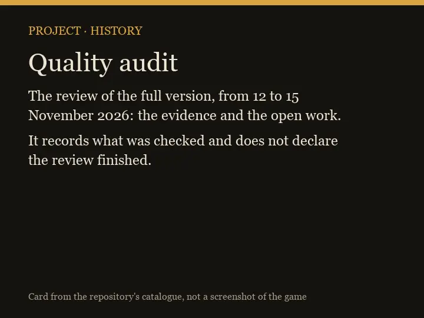

# Quality audit

The quality audit was the review of the complete version of the game: its look, its functions and its play. It started on 12 November 2026 and went through more than a dozen dated passes, each one with the checks it ran and what it found. [docs/history/quality-audit.md](../../docs/history/quality-audit.md) keeps the evidence of every pass.

The subjects of the passes were the arms and the movement, the aiming, the menus with a controller, the co-op menu, the rooms and their verticality, the HUD of combat, the source of the damage, the melee, the hordes and their rendering cost, the cover in the rooms, the magic and the physical hits, the lighting, and the wave cycle.

## Status

The history's status note says what has changed since each pass: the co-op protocol, the number of weapons, the default cycle (now the waves), and the builds the player runs. Read that note before a dated section, because the sections keep the state of their day.

## Related

- [Survival redesign](zombies-redesign.md): the change of rhythm that the audit checked.
- [The Unity game](unity-game.md): the project that was audited.
- [Testing and verification](../../docs/engineering/testing.md): the checks the passes used.
