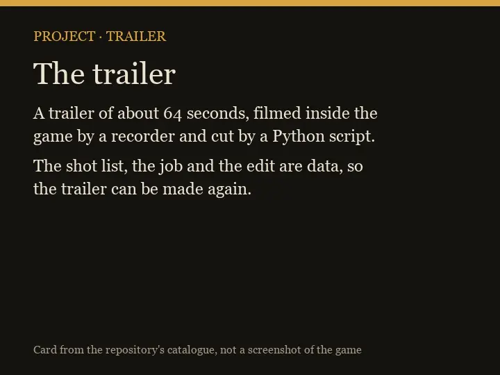

# The trailer

The trailer is made without an editing program. A recorder inside the player films a shot list: a free camera or a first-person player with a weapon, the enemies that the shots need, and the events of each shot. Python scripts then cut the clips, add the captions, the title card and a score made of the game's own sounds. [docs/engineering/trailer.md](../../docs/engineering/trailer.md) describes each piece and how to make the film again.

The recorder is in the game's code and is left out of the distribution build (`PE_DISTRIBUTION_BUILD`). A scripts-only build is enough to film with it. Everything is data: a different cut or a better shot is a new run, not a new edit by hand.

## Checks

`tools/test_trailer.py` tests the timeline, and `tools/trailer/trailer_check.py` checks the finished film: its information, a contact sheet of its segments and its loudness.

## Related

- [The Unity game](unity-game.md): the game the trailer is filmed from.
- [Ship](../pipeline/ship.md): the script that builds the scripts-only build the recorder needs.
- [Testing and verification](../../docs/engineering/testing.md): the other checks of the project.
