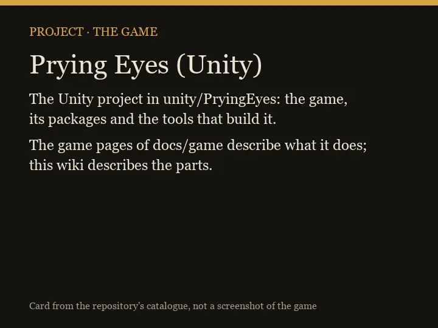

# The Unity game

The game is the Unity project in `unity/PryingEyes`, built with Unity 6000.6.7f1. The only scene of the player is `Assets/_PryingEyes/Scenes/Torre.unity`. Its floors are generated at run time from a seed, and the desert is the second of its two modes. The game is the project the whole wiki describes: the two [modes](../modes/standard.md) and their [pages](../catalog.md).

## The parts of the project

- `Assets/_PryingEyes/Scripts`: the game's code, with the [procedural floors](../zones/catacombs.md), the [enemies](../enemies/monk.md), the [weapons](../weapons/pieta-p9.md) and the [desert](../modes/desert.md).
- `Assets/_PryingEyes/Editor`: the build methods, such as `BuildPlayer.Torre`, that make the players.
- `Packages/`: the five rule [packages](../packages/saves.md) the production suite reuses.
- `Resources/Production`: the catalogues the production studio reads, such as the weapons.
- `unity/LayoutDemo`: a second, independent project that uses the packages through file references, which proves that they can be reused.

## Builds

The build the maintainer plays is `unity/PryingEyes/Builds/PryingEyes.exe`. Builds and checks run in `Builds/Audit`, and the released zips are in `Builds/Releases`. The build methods and the folders are described in [building, shipping and CI](../../docs/engineering/building-and-shipping.md).

## Related

- [Ship](../pipeline/ship.md): the script that builds and pushes the project.
- [Release](../pipeline/release.md): how a version is prepared for the players.
- [Quality audit](quality-audit.md): the review of the complete version of this project.
