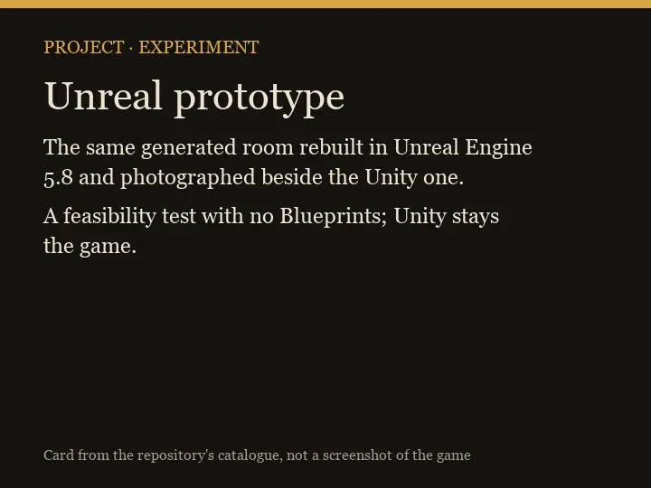

# Unreal prototype

The Unreal prototype asks one question: could the game's look and speed be kept in another engine? It takes one room of a generated floor, with the same seed and the same camera, rebuilds it in Unreal Engine 5.8 from what the Unity game produced, and photographs it in both engines. Unity stays the game, and nothing in the game depends on this folder. The rule of the prototype is no Blueprints: C++ runs the level and Python runs in the editor for the imports. [docs/engineering/unreal-prototype.md](../../docs/engineering/unreal-prototype.md) has the steps and the traps.

## What it measured

On one room (seed 1000, floor 1, a 17.6 by 19.2 m restaurant), at 1920 by 1080, one view, one graphics card, the Unreal scene with Lumen took 4.65 ms and the Unity batch render took 7.76 ms. Those are two numbers from one view, not a ratio. The document reads them as "the same order of magnitude, with Unreal paying about 1.2 ms for Lumen". The tone was fitted once on a ramp of 30 patches and was within 1.4 display levels in the mean.

## Related

- [Earlier versions](legacy-versions.md): the earlier Unreal prototype, which was a playable game.
- [The Unity game](unity-game.md): the game this room comes from.
- [Testing and verification](../../docs/engineering/testing.md): the checks of the Unity side.
