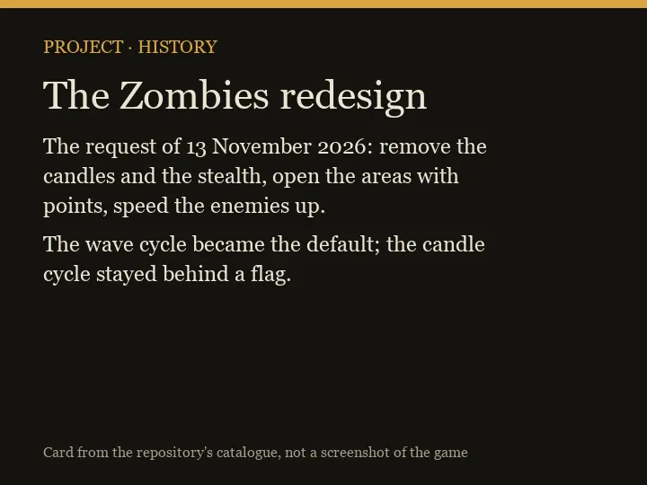

# Survival redesign

On 13 November 2026 the maintainer asked for the Tower to play at the pace of Call of Duty Zombies. The request was to remove the candles to light and the stealth mechanics, to have fewer and larger rooms on each floor, to open areas by paying points, and to make the enemies faster. [docs/history/zombies-redesign.md](../../docs/history/zombies-redesign.md) keeps the seventeen passes that carried it out, from the scale and the vertical routes to the wave cycle.

The result is the [wave cycle](../cycles/wave-cycle.md), now the default. The [candle cycle](../cycles/candle-cycle.md) is kept behind the `-candles` flag, and the [stealth](../systems/stealth.md) rules still belong to it.

## Passes

The passes follow the order of the work: the scale of the floors and their routes, the shapes and the functions, the layout of the HUD, the darts and the contacts, the melee of the humanoids, the torch and the costumes, the votive effigy and the timing of the replica, the lunge of the flying enemies, the density of the hordes, the light small hordes, the cover in the rooms, the physical contact, the weapon in hand, the crowds and the balconies, the supplies in the arenas, and the wave cycle itself.

## Related

- [The wave cycle](../cycles/wave-cycle.md): what the redesign produced.
- [Quality audit](quality-audit.md): the review that followed the redesign.
- [Earlier versions](legacy-versions.md): the versions before it.
