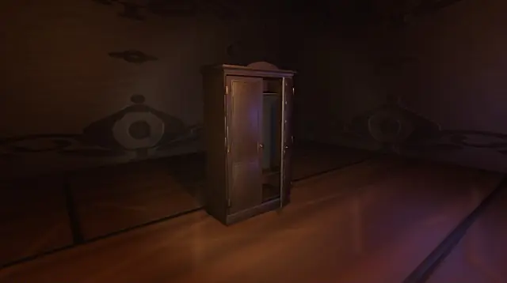

# The wardrobe

The wardrobe (`arr_armadio`) is a two-door cabinet with a moulded plinth and cornice, a segmental pediment, raised panels and brass hinges,
knobs and escutcheons. Its left door stands ajar on a red velvet lining, with a hanging rail and three dark coats.

## What it is

- **Model.** A moulded plinth and cornice, a segmental pediment, raised panels, brass hinges, knobs and escutcheons, and the ajar door.
- **Size.** Model 1.35 x 2.30 x 1.04 m, the body 0.62 m deep; collider 1.3 x 2.2 x 0.62 m (`PropDefs.cs`).
- **Edges.** The ajar door sticks out about 0.4 m in front of the 0.62 m body. The collider is the body, so the door is visible but has no
  collision of its own.
- **Levels of detail.** Three levels: the model, then 28 % and 9 % of its triangles.

## Numbers

- **Triangles.** 6,056 at level 0, 1,690 at level 1, 558 at level 2. The FBX it replaced had 848.
- **Placements.** 1,144 in 500 generated floors (`-propstats`).

## Where it stands

- In the hotel's bedrooms (`RoomKitsAlbergo.cs`).
- In the theatre's dressing room, and along a wall of its corridor in 35 % of the cases (`RoomKitsTeatro.cs`).
- In the cathedral's sacristy (`RoomKits.Hub.cs`).
- As cover, with a weight of 2 (`RoomKitsCover.cs`).

## Standard and desert

- **Standard.** The hotel bedrooms, the theatre's dressing room and corridor, the sacristy of the cathedral's hub, and the cover kit.
- **Desert.** The desert's hotels and theatres are dressed by the same room kits (`DesertSites.cs`, `DressNext`), so wardrobes stand there too.

## Related

- [The bedside table](arr-comodino.md): the piece that stands beside a bed.
- [The writing desk](arr-scrivania.md): the desk of the same bedrooms.
- [The theatre](../places/theatre.md): the desert place built from theatre rooms.
- [The sacristy](../works/la-sacrestia.md): the cathedral work whose room the hub furnishes with a wardrobe.
