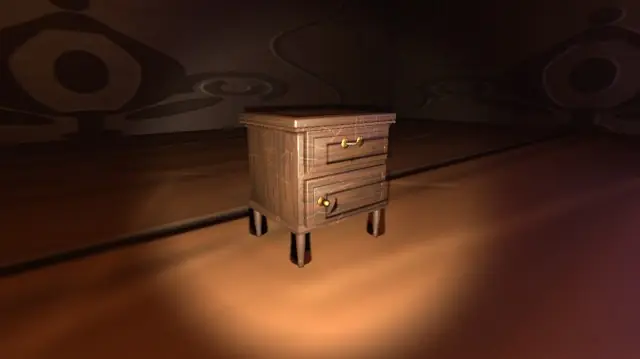

# The bedside table

The bedside table (`arr_comodino`) has a moulded top and base, four turned tapering legs, a drawer and a door with raised panel fields, and
brass fittings: a bail pull, a knob and a keyhole plate.

## What it is

- **Model.** A moulded top and base, four turned tapering legs, a drawer, a door with raised panel fields, and the brass fittings.
- **Size.** Model 0.50 x 0.55 x 0.46 m; collider 0.5 x 0.55 x 0.42 m (`PropDefs.cs`).
- **Levels of detail.** Three levels: the model, then 28 % and 9 % of its triangles.

## Numbers

- **Triangles.** 2,566 at level 0, 702 at level 1, 224 at level 2. The FBX it replaced had 576.
- **Placements.** 1,254 in 500 generated floors (`-propstats`).

## Where it stands

- Beside the beds of the hotel's bedrooms (`RoomKitsAlbergo.cs`).
- In the sanatorium's rooms, with a 75 % chance at each place the kit picks (`RoomKitsSanatorio.cs`).

## Standard and desert

- **Standard.** The hotel's bedrooms and the sanatorium's wards.
- **Desert.** The desert's hotels and sanatoria are dressed by the same room kits (`DesertSites.cs`, `DressNext`), so the bedside tables stand
  beside the beds there too.

## Related

- [The wardrobe](arr-armadio.md): the other piece of the bedroom.
- [The writing desk](arr-scrivania.md): the desk of the same bedrooms.
- [The hotel](../places/hotel.md): the desert place built from hotel rooms.
- [The sanatorium](../places/sanatorium.md): the desert place built from sanatorium wards.
