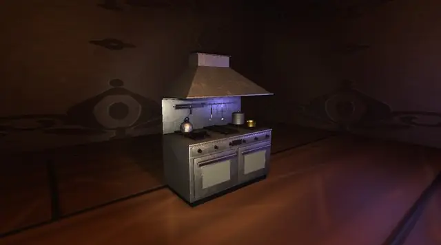

# The range cooker

The range cooker (`arr_fornello`) is a steel range: a dark plinth and a rounded body, a hob with a rim, six burners, a control strip with six
knobs and a clock, and two doors with glass windows and bar handles. Over the hob is a hood with its chimney. On the cooker stand a stock pot,
a kettle, a copper saucepan and a frying pan; on the pot rail hang a ladle, a turner and a cleaver.

## What it is

- **Model.** The steel range with its hob, burners, control strip, doors and hood, plus the pots and utensils on it.
- **Size.** Model 1.74 x 2.21 x 0.95 m; collider 1.7 x 2.2 x 0.85 m (`PropDefs.cs`).
- **Edges.** The knobs and handles stand 0.08 m in front of the body, so the model is 0.95 m deep against the 0.85 m collider. The hood's lower
  edge is 1.56 m up, and the collider is solid up to 2.2 m, so nobody walks under it.
- **Levels of detail.** Three levels: the model, then 28 % and 9 % of its triangles.

## Numbers

- **Triangles.** 11,486 at level 0, 3,206 at level 1, 1,040 at level 2. The FBX it replaced had 1,528.
- **Placements.** 634 in 500 generated floors (`-propstats`).

## Where it stands

- In the hotel kitchen, in a row along the far wall, 0.45 m from it (`RoomKitsAlbergo.cs`, `Cucina`).
- In the wardrobe's forge, against a wall, one per bay (`RoomKitsGuardaroba.cs`, `Forgia`).

## Standard and desert

- **Standard.** The hotel kitchen of the standard floors, and the forge of the [Guardaroba branch](../branches/guardaroba.md).
- **Desert.** The desert's hotels are dressed by the same room kits (`DesertSites.cs`, `DressNext`), so cookers stand in their kitchens too.

## Related

- [The steel work table](arr-tavolo-acciaio.md): the work table of the same kitchen.
- [The hotel](../places/hotel.md): the desert place built from hotel rooms.
- [The Guardaroba branch](../branches/guardaroba.md): the standard branch with the wardrobe's forge.
