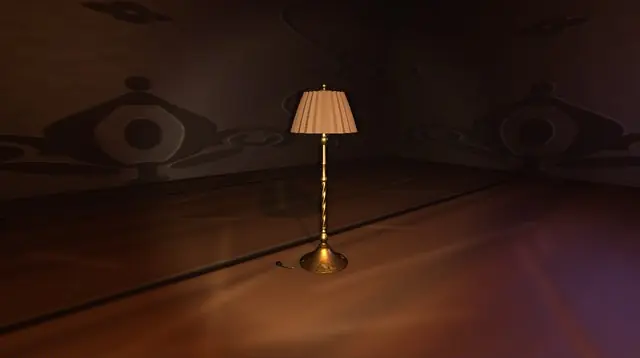

# The floor lamp

The floor lamp (`arr_lampada`) is a lamp of turned brass: a weighted stepped base, knops and collars, a rope-twist stem, a socket with a rotary
switch, a bulb in a wire harp, and an empire shade of 24 accordion pleats. A cord with its plug lies on the floor.

## What it is

- **Model.** The weighted base, the rope-twist stem, the socket and switch, the bulb in its wire harp, the finial, the pleated shade, and the
  cord with its plug on the floor. The shade and the bulb share one material role and glow together.
- **Size.** Model 0.61 x 1.48 x 0.52 m; collider 0.42 x 1.45 x 0.42 m (`PropDefs.cs`).
- **Edges.** The shade is 0.52 m across, against the 0.42 m collider. The cord and plug lie up to 0.34 m from the axis, 0.13 m beyond the
  collider on the +X side. The room's pooled light sits 1.25 m above the lamp's origin.
- **Levels of detail.** Three levels: the model, then 28 % and 9 % of its triangles.

## Numbers

- **Triangles.** 8,766 at level 0, 2,440 at level 1, 782 at level 2. The FBX it replaced had 1,256.
- **Placements.** 485 in 500 generated floors (`-propstats`).

## Where it stands

- In the hotel's atrium, lit in 70 % of the cases (`RoomKitsAlbergo.cs`, `FloorLampProp`).
- In the sanatorium's rooms, lit in 60 % of the cases (`RoomKitsSanatorio.cs`).
- On the stage of the theatre (`RoomKitsTeatro.cs`).
- In the spaces of the standard floors, on either side and always lit (`RoomKits.Spaces.cs`).

## Breaking

`BreakableLamps.cs` lists the lamps a shot can put out: `Abatjour`, `Lampadina`, `Neon`, `Applique`, `arr_lampada` and `AstaScialitica`.
The breakable-lamps note says the shade and bulb swap to unlit materials. The phase-5 note found that a shot floor lamp's shade probably is not
swapped, so the lamp probably keeps glowing; neither was tried in the game (see [broken lamps](../hazards/broken-lamps.md)).

## Standard and desert

- **Standard.** The hotel atrium, the sanatorium's rooms, the theatre stage and the spaces of the standard floors.
- **Desert.** The desert's hotels, sanatoria and theatres are dressed by the same room kits (`DesertSites.cs`, `DressNext`), so floor lamps stand
  there too. Whether a shot lamp goes dark there is the same open question as in the standard floors.

## Related

- [The broken lamps](../hazards/broken-lamps.md): the lamps that a shot can put out.
- [The falling chandeliers](../hazards/chandeliers.md): the other electric light that a shot can bring down.
- [Floor power](../systems/floor-power.md): the power of the floor, which the lights depend on.
