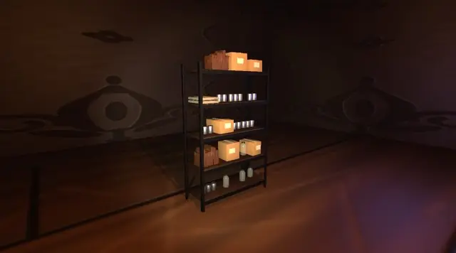

# The warehouse shelf

The warehouse shelf (`arr_scaffale`) is an angle-iron shelving unit of five wooden shelves with steel edges, cross braces and a varied load:
taped cardboard boxes with labels, glass jars, tins, folded linen and books.

## What it is

- **Model.** Angle-iron uprights, five wooden shelves with steel edges, cross braces, and the load.
- **Size.** Model 1.20 x 2.08 x 0.45 m; collider 1.2 x 1.9 x 0.45 m (`PropDefs.cs`).
- **Levels of detail.** Three levels: the model, then 28 % and 9 % of its triangles. At the lowest level the steel uprights break into segments.

## Numbers

- **Triangles.** 6,760 at level 0, 1,884 at level 1, 610 at level 2. The FBX it replaced had 1,232.
- **Placements.** 2,406 in 500 generated floors (`-propstats`).

## Where it stands

- Along the walls of the hotel's service room and kitchen (`RoomKitsAlbergo.cs`).
- Along the walls of the sanatorium's rooms, in rows and in pairs (`RoomKitsSanatorio.cs`).
- In the theatre's Ridotto and storeroom (`RoomKitsTeatro.cs`).
- Along the walls of the wardrobe's tailor's room, with cloths on the shelves (`RoomKitsGuardaroba.cs`).
- As cover, with weights of 1.2 and 1 (`RoomKitsCover.cs`).
- In the cathedral's sacristy, beside the treasury (`RoomKits.Hub.cs`).

## Standard and desert

- **Standard.** The four theme kits above, the cover kit, and the sacristy of the cathedral's hub, next to [the treasury](../works/il-tesoro.md).
- **Desert.** The desert's places are dressed by the same room kits (`DesertSites.cs`, `DressNext`), so shelves stand in its hotels, theatres
  and sanatoria.

## Related

- [The steel work table](arr-tavolo-acciaio.md): the work table of the same kitchens and wards.
- [The treasury](../works/il-tesoro.md): the cathedral work beside which the hub places a shelf.
- [The sanatorium](../places/sanatorium.md): the desert place built from sanatorium wards.
- [The theatre](../places/theatre.md): the desert place built from theatre rooms.
