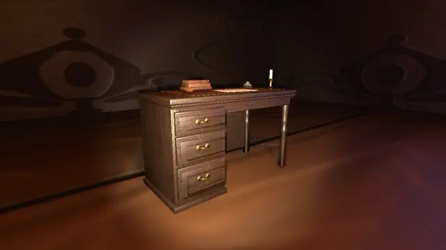

# The writing desk

The writing desk (`arr_scrivania`) has a moulded top with an inset leather writing surface edged in brass wire, and a pedestal of three
drawers with bail pulls and a keyhole, on turned legs. On top: an inkwell, a sheet of paper, a pile of books and a candlestick.

## What it is

- **Model.** The moulded top with its leather writing surface, the pedestal of three drawers, the turned legs, and the things on top.
- **Size.** Model 1.25 x 0.94 x 0.65 m; collider 1.25 x 0.76 x 0.62 m (`PropDefs.cs`).
- **Edges.** The candlestick makes the model 0.94 m tall, against the 0.76 m collider.
- **Levels of detail.** Three levels: the model, then 28 % and 9 % of its triangles.

## Numbers

- **Triangles.** 5,726 at level 0, 1,582 at level 1, 504 at level 2. The FBX it replaced had 636.
- **Placements.** 611 in 500 generated floors (`-propstats`).

## Where it stands

- In a hotel bedroom, against a wall with its chair in front (`RoomKitsAlbergo.cs`).
- In a sanatorium room longer than 5 m, 60 % of the time, with a chair in front; in other sanatorium rooms, against a wall with a chair (`RoomKitsSanatorio.cs`).

## Standard and desert

- **Standard.** The hotel's bedrooms and the sanatorium's longer rooms.
- **Desert.** The desert's hotels and sanatoria are dressed by the same room kits (`DesertSites.cs`, `DressNext`), so desks stand there too.

## Related

- [The dining chair](arr-sedia.md): the chair that stands at the desk.
- [The wardrobe](arr-armadio.md): the other large piece of the bedroom.
- [The bedside table](arr-comodino.md): the table of the same bedrooms.
- [The sanatorium](../places/sanatorium.md): the desert place built from sanatorium wards.
