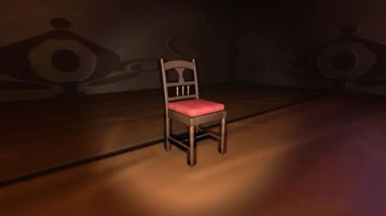

# The dining chair

The dining chair (`arr_sedia`) is a wooden chair with turned front legs, rear posts that curve back into the backrest, an arched crest rail, a
vase-shaped splat and an upholstered seat with brass studs. It is the most placed of the sixteen props rebuilt in phase 5.

## What it is

- **Model.** Turned front legs, rear posts that curve into the backrest, an arched crest rail, a vase-shaped splat, three turned spindles,
  turned stretchers, and an upholstered seat with a crown, piping and brass studs.
- **Size.** Model 0.42 x 0.89 x 0.48 m; collider 0.5 x 0.92 x 0.5 m (`PropDefs.cs`).
- **Levels of detail.** Three levels: the model, then 28 % and 9 % of its triangles.

## Numbers

- **Triangles.** 8,404 at level 0, 2,350 at level 1, 754 at level 2. The FBX it replaced had 952.
- **Placements.** 5,163 in 500 generated floors (`-propstats`).

## Where it stands

- The hotel kit (`RoomKitsAlbergo.cs`) puts chairs beside the restaurant tables, 0.78 m from the table's centre and turned by up to 30 degrees;
  at the desk of a bedroom; and in rows in the ballroom.
- The sanatorium kit (`RoomKitsSanatorio.cs`) places chairs in rows, beside its tables and at its desks.
- The theatre kit (`RoomKitsTeatro.cs`) places them in the Ridotto, on the stage, in the dressing room and in the storeroom.

## Standard and desert

- **Standard.** The hotel, sanatorium and theatre kits above, which dress the floors of the standard game (the hotel floors are part of the
  [Ossario branch](../branches/ossario.md)).
- **Desert.** The desert's places are dressed by the same room kits (`DesertSites.cs`, `DressNext`), so the chairs stand in its hotels, theatres
  and sanatoria wherever those kits place them.

## Related

- [The dining table](arr-tavolo.md): the table the restaurant chairs stand around.
- [The writing desk](arr-scrivania.md): the desk that a bedroom chair stands at.
- [The hotel](../places/hotel.md): the desert place built from hotel rooms.
- [The theatre](../places/theatre.md): the desert place built from theatre rooms.
