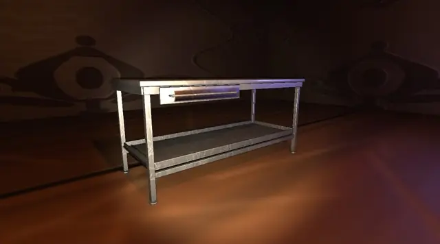

# The steel work table

The steel work table (`arr_tavolo_acciaio`) is a workbench with a top with a rolled edge, a drawer with a bar handle, a lower shelf and four
legs with feet.

## What it is

- **Model.** A rolled-edge top, a drawer with a bar handle, a lower shelf, and four legs with feet.
- **Size.** Model 1.90 x 0.90 x 0.84 m; collider 1.9 x 0.9 x 0.8 m (`PropDefs.cs`).
- **Levels of detail.** Three levels: the model, then 28 % and 9 % of its triangles.

## Numbers

- **Triangles.** 1,620 at level 0, 450 at level 1, 144 at level 2. The FBX it replaced had 192.
- **Placements.** 531 in 500 generated floors (`-propstats`).

## Where it stands

- In a row across the hotel's kitchen, 40 % of the way into the room (`RoomKitsAlbergo.cs`, `Cucina`).
- In the sanatorium's rooms: as a central table and in rows (`RoomKitsSanatorio.cs`).
- As cover, with weights of 1.2 and 1.5 (`RoomKitsCover.cs`).

## Standard and desert

- **Standard.** The hotel kitchen and the sanatorium's rooms, and the cover kit.
- **Desert.** The desert's hotels and sanatoria are dressed by the same room kits (`DesertSites.cs`, `DressNext`), so work tables stand there too.

## Related

- [The range cooker](arr-fornello.md): the cooker along the far wall of the same kitchen.
- [The warehouse shelf](arr-scaffale.md): the shelf of the same kitchens and wards.
- [The hotel](../places/hotel.md): the desert place built from hotel rooms.
