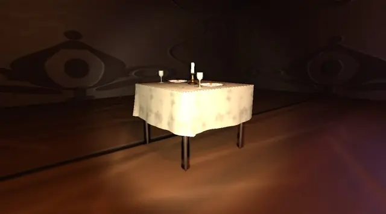

# The dining table

The dining table (`arr_tavolo`) is a square table under a long cloth, with four turned legs under it, a brass candlestick with a burnt candle
and wax drips, and two place settings: a plate, a glass and cutlery at each place.

## What it is

- **Model.** A generated cloth shell with folds and a hem over the four legs, the candlestick, and the two place settings.
- **Size.** Model 1.09 x 1.00 x 1.09 m; collider 0.95 x 0.76 x 0.95 m (`PropDefs.cs`).
- **Cloth against the collider.** The cloth is 1.09 m wide, so it reaches past the collider. Chairs placed 0.78 m from the centre stand about
  3 cm from the cloth, and a chair turned by up to 30 degrees can touch it by a few centimetres.

## Numbers

- **Triangles.** 8,508 at level 0, 2,376 at level 1, 758 at level 2. The FBX it replaced had 464.
- **Placements.** 4,917 in 500 generated floors (`-propstats`).

## Where it stands

- The hotel kit (`RoomKitsAlbergo.cs`) puts one in the restaurant, with its chairs around it.
- The sanatorium kit (`RoomKitsSanatorio.cs`) places tables with chairs on either side.
- The theatre kit (`RoomKitsTeatro.cs`) places them in the Ridotto, on the stage and in the storeroom.
- The cathedral's hub puts one in the sacristy (`HubSacristy` in `RoomKits.Hub.cs`).

## Standard and desert

- **Standard.** The restaurant, sanatorium and theatre kits above, and the sacristy of the cathedral's hub.
- **Desert.** The desert's cathedral has its own hub (`RoomKits.HubDeserto.cs`): its armoury (`HubArmory`) puts one table at the centre of the
  room, between the weapon panels on the walls. The desert's places are dressed by the same room kits as the standard floors.

## Related

- [The dining chair](arr-sedia.md): the chairs of the restaurant.
- [The steel work table](arr-tavolo-acciaio.md): the work table of the kitchen and the sanatorium.
- [The sacristy](../works/la-sacrestia.md): the cathedral work whose room the hub furnishes with this table.
- [The hotel](../places/hotel.md): the desert place built from hotel rooms.
