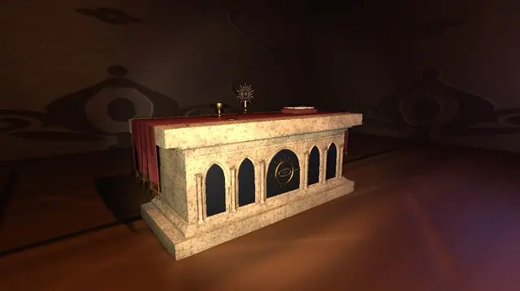

# The stone altar

The stone altar (`chi_altare`) is an altar of ashlar stone: a plinth and a moulded base, a body with a blind arcade of five pointed arches, and
in the middle one the golden Eye in a medallion with sixteen rays. A slab with consecration crosses holds a velvet cloth, a missal on a cushion,
a chalice and a paten, and a monstrance with the Eye and twenty rays.

## What it is

- **Model.** The plinth and base, the ashlar body with its blind arcade, the golden Eye in the middle medallion, the cornice, the consecration
  slab, the velvet cloth with its gold border and fringe, the missal, the chalice and paten, and the monstrance.
- **Size.** Model 2.47 x 1.35 x 1.00 m; collider 2.4 x 1.05 x 1.0 m (`PropDefs.cs`).
- **Edges.** The monstrance reaches 1.35 m, against the 1.05 m collider. The cloth hangs 3 cm beyond each end.
- **Levels of detail.** Three levels: the model, then 28 % and 9 % of its triangles.

## Numbers

- **Triangles.** 11,758 at level 0, 3,286 at level 1, 1,052 at level 2. The FBX it replaced had 1,152.
- **Placements.** 347 in 500 generated floors (`-propstats`).

## Where it stands

- In a church presbytery, against the far wall (`RoomKitsChiesa.cs`, `Presbiterio`).
- In a church chapel, facing the door (`RoomKitsChiesa.cs`, `Cappella`).
- In the choir of the cathedral's hub (`HubChoir` in `RoomKits.Hub.cs`).
- In the annexes: at 90 % of its size in `FloorBuilder.Annex.cs`, and at 80 % in `AnnexRuntime.cs`.

## Standard and desert

- **Standard.** The church kit's presbyteries and chapels, the cathedral's choir, and the annexes.
- **Desert.** The desert's own altar is the [Altar of Consecration](../works/altare-della-consacrazione.md), a desert-only work in the presbytery.
  The stone altar comes from the same room kits in the desert's churches and chapels (`DesertSites.cs`, `DressNext`).

## Related

- [L'Altare maggiore](../works/laltare-maggiore.md): the cathedral's high-altar work.
- [The Altar of Consecration](../works/altare-della-consacrazione.md): the desert's altar work.
- [The stone sarcophagus](chi-sarcofago.md): the other stone piece of the crypts.
- [The church](../places/church.md): the desert place with a nave and a yard.
