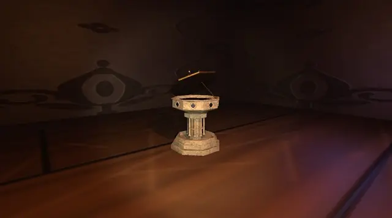

# The baptismal font

The baptismal font (`chi_fonte`) is an octagonal stone font: a stepped plinth, a pier with eight colonnettes, a bowl with eight quatrefoil
reliefs full of black water, and a pyramidal oak lid hinged at the back and propped open at 30 degrees by a brass stay.

## What it is

- **Model.** The stepped plinth and moulded base, the pier with eight colonnettes and a band, the capital, the bowl with its rim and quatrefoil
  reliefs, the black water, and the pyramidal oak lid with its eight corner ribs, brass band and finial.
- **Size.** Model 0.90 x 1.47 x 0.92 m with the lid open; collider 0.9 x 1.1 x 0.9 m (`PropDefs.cs`). The open lid reaches 1.47 m, above the collider.
- **Scale.** The rooms scale the font: 1.3 in a rotunda, 1.5 in the garden annex, and 2.4 in the centre of the winter garden, where the open lid
  is about 3.5 m up.
- **Levels of detail.** The font keeps 30 % and 16 % of its triangles, not 28 % and 9 %, because its eight colonnettes break into spikes at 9 %.

## Numbers

- **Triangles.** 5,648 at level 0, 1,712 at level 1, 924 at level 2. The FBX it replaced had 470.
- **Placements.** 36 in 500 generated floors (`-propstats`), the fewest of the sixteen.

## Where it stands

- In the cathedral's hub, at the centre of a hub room, once the font's work is built, with candles round it and a brighter light
  (`RoomKits.Hub.cs`). Until then the work's construction site stands in its place; the cathedral test checks that the site is gone and the font
  is there (`CattedraleTest.cs`).
- In a rotunda, at its centre, at 1.3 scale (`RoomKits.Spaces.cs`).
- In the winter garden, at its centre, at 2.4 scale (`RoomKits.cs`).
- In a church narthex, two fonts, one of them turned by 37 degrees (`RoomKitsChiesa.cs`, `Nartece`).
- In the garden annex, at 1.5 scale (`FloorBuilder.Garden.cs`).

## Standard and desert

- **Standard.** The cathedral's hub, rotundas, the winter garden, the church narthex and the garden annex.
- **Desert.** The desert's places are dressed by the same room kits, so a font can stand in a desert rotunda or church. The desert's cathedral
  has its own hub (`RoomKits.HubDeserto.cs`), which does not place the font.

## Related

- [The baptismal font (work)](../works/la-fonte-battesimale.md): the cathedral's work that brings the font to the hub. Once built, every catacomb
  level starts with at least three holy waters.
- [Holy water](../throwables/holy-water.md): the flask that the font's work supplies.
- [The stone altar](chi-altare.md): the altar of the same churches and annexes.
