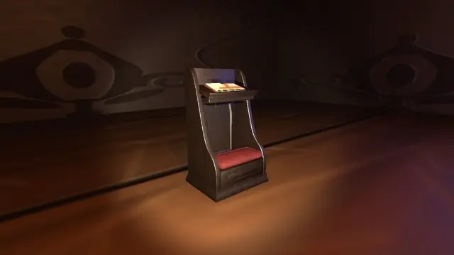

# The prie-dieu

The prie-dieu (`chi_inginocchiatoio`) is a praying desk: a moulded plinth, side cheeks with a curved profile, a padded kneeler with piping and
studs under a panel front, a back with a raised pointed arch and a brass cross, and a sloped lectern with a lip and an open book.

## What it is

- **Model.** The moulded plinth, the curved side cheeks, the padded kneeler, the back with its pointed arch and brass cross, and the sloped
  lectern with its open book.
- **Size.** Model 0.56 x 0.96 x 0.46 m; collider 0.6 x 0.95 x 0.5 m (`PropDefs.cs`).
- **Levels of detail.** Three levels: the model, then 28 % and 9 % of its triangles.

## Numbers

- **Triangles.** 3,358 at level 0, 936 at level 1, 296 at level 2. The FBX it replaced had 604.
- **Placements.** 412 in 500 generated floors (`-propstats`).

## Where it stands

- In the church kit's chapels (`RoomKitsChiesa.cs`, `Cappella`): one, and a second in 60 % of the cases.
- In the cathedral's chapel works, 1.4 m from a statue (`HubChapel` in `RoomKits.Hub.cs`).
- As cover, with a weight of 0.7 (`RoomKitsCover.cs`).

## Standard and desert

- **Standard.** The church kit's chapels, the cathedral's chapel works, and the cover kit.
- **Desert.** The desert's chapels and churches are dressed by the same room kits (`DesertSites.cs`, `DressNext`), so prie-dieux stand there too.

## Related

- [The chapel](../places/chapel.md): the small desert place marked with a cross on the minimap.
- [The church pew](chi-panca.md): the seating of the nave.
- [The hooded monk statue](chi-statua.md): the statue that stands beside it in the chapel works.
- [The stone altar](chi-altare.md): the altar of the same chapels.
