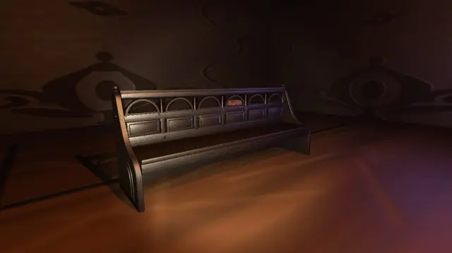

# The church pew

The church pew (`chi_panca`) is a long bench: side panels with a curved profile and two raised Gothic arches, a back of panel fields under a
row of arched tracery, a hymn rack with books and a padded kneeler on brackets.

## What it is

- **Model.** Side panels with a curved profile and raised Gothic arches, a turned finial, a rounded seat edge, a back of panel fields under
  arched tracery, a hymn rack with books, and a padded kneeler on brackets.
- **Size.** Model 2.63 x 1.08 x 0.90 m; collider 2.6 x 0.95 x 0.9 m (`PropDefs.cs`).
- **Levels of detail.** Three levels: the model, then 28 % and 9 % of its triangles.

## Numbers

- **Triangles.** 8,500 at level 0, 2,378 at level 1, 760 at level 2. The FBX it replaced had 1,868.
- **Placements.** 2,910 in 500 generated floors (`-propstats`), the most of the church props.

## Where it stands

- The church kit's nave (`RoomKitsChiesa.cs`, `Navata`) places them in rows, each row scaled to its block from 42 % to 100 % of the pew's length,
  with small random turns, and some turned by 14 to 24 degrees.
- A church rotunda gets four seats round its centre: pews in a church, sofas (`arr_divano`) anywhere else (`RoomKits.Spaces.cs`).
- The cathedral's hub places them in its nave (`HubNave` in `RoomKits.Hub.cs`).
- The garden annex puts a ring of pews round its fountain (`FloorBuilder.Garden.cs`).
- The wardrobe's changing room and terrace place them (`RoomKitsGuardaroba.cs`), and the arena kit uses them as benches in churches
  (`RoomKitsArena.cs`).

## Standard and desert

- **Standard.** The church nave, the rotundas of the standard floors, the garden annex, the cathedral's nave, and the wardrobe's rooms.
- **Desert.** The desert's churches have a nave and are dressed by the same room kits (`DesertSites.cs`, `DressNext`), so pews stand in their
  naves. The desert's rotundas and churches are dressed the same way.

## Related

- [The prie-dieu](chi-inginocchiatoio.md): the kneeler of the chapels.
- [The choir stall](chi-stallo.md): the seating beside the presbytery.
- [The church](../places/church.md): the desert place with a nave.
- [The Ossario branch](../branches/ossario.md): the standard branch with church floors.
