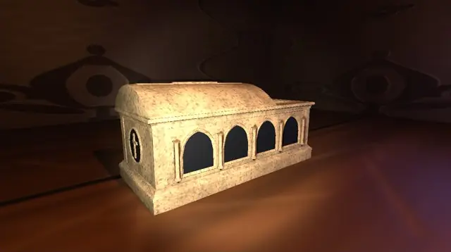

# The stone sarcophagus

The stone sarcophagus (`chi_sarcofago`) is a tomb of moulded stone: a plinth, corner piers, a blind arcade of relief arches and colonnettes on
each long side, a medallion cross on each end, and a rounded lid with a ridge band and a cross, slid aside to show the inside.

## What it is

- **Model.** A moulded plinth, corner piers, a blind arcade on each long side (relief arches, colonnettes, dark niches), a medallion cross on
  each end, a crown moulding, and a rounded lid with a ridge band and a cross. The lid is slid aside to show a dark floor, a skull, two femurs,
  ribs and vertebrae.
- **Size.** Model 2.37 x 1.00 x 1.00 m; collider 2.3 x 1.0 x 1.0 m (`PropDefs.cs`).
- **Edges.** The lid overhangs the body by 3 cm. It is not a separate object and does not move.
- **Levels of detail.** Three levels: the model, then 28 % and 9 % of its triangles.

## Numbers

- **Triangles.** 13,432 at level 0 (the most of the sixteen), 3,758 at level 1, 1,206 at level 2. The FBX it replaced had 788.
- **Placements.** 1,188 in 500 generated floors (`-propstats`).

## Where it stands

- In the cathedral's crypt (`HubCrypt` in `RoomKits.Hub.cs`), the room of [the crypt work](../works/lossario.md).
- In a sealed annex of the standard floors (`FloorBuilder.Annex.cs`), at full size.
- In the sacrario room (`FloorBuilder.Sacrario.cs`), at 92 % of its size.
- As cover, with a weight of 1.4 (`RoomKitsCover.cs`).

## Standard and desert

- **Standard.** The cathedral's crypt, the sealed annexes, the sacrario room and the cover kit.
- **Desert.** The desert's catacombs are built from floors and dressed by the same room kits (`DesertSites.cs`, `DressNext`). The desert's
  cathedral has its own hub (`RoomKits.HubDeserto.cs`), so the crypt hub is the standard cathedral's.

## Related

- [L'Ossario](../works/lossario.md): the cathedral's crypt work, whose room holds this tomb.
- [The catacombs](../zones/catacombs.md): the standard way down, with procedural floors.
- [The catacomb](../stacks/catacomb.md): the desert stack built as a mausoleum.
- [The stone altar](chi-altare.md): the other stone piece of the crypts and annexes.
