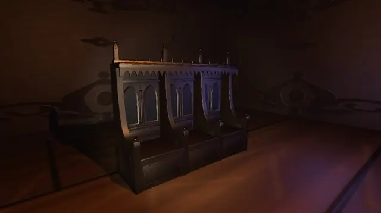

# The choir stall

The choir stall (`chi_stallo`) is an oak seat for three: four standards, each cut as one plate with a concave sweep and a round poppyhead,
panel fields on every face, a base with panelled fronts, three seats, and a panelled back with two pointed-arch niches. A canopy with a valance
of 24 small pointed arches, a cornice, a crest and four pinnacles stands above.

## What it is

- **Model.** Four oak standards with concave sweeps and round poppyheads, panel fields on every face, a base with three seats, a panelled back
  with niches and a colonnette per seat, a canopy with a valance of 24 pointed arches, and a crest with cones and a gold band.
- **Size.** Model 2.82 x 2.33 x 0.89 m; collider 2.8 x 2.3 x 0.9 m (`PropDefs.cs`).
- **Edges.** The pinnacles reach 2.33 m, against the 2.3 m collider.
- **Levels of detail.** Three levels: the model, then 28 % and 9 % of its triangles.

## Numbers

- **Triangles.** 8,958 at level 0, 2,504 at level 1, 804 at level 2. The FBX it replaced had 1,492.
- **Placements.** 473 in 500 generated floors (`-propstats`).

## Where it stands

- The church kit places them along both sides of the presbytery (`RoomKitsChiesa.cs`, `Presbiterio`).

## Standard and desert

- **Standard.** The presbytery of the church kit in the standard floors.
- **Desert.** The desert's churches are dressed by the same room kits (`DesertSites.cs`, `DressNext`), so the stalls can stand in a desert church
  that has a presbytery.

## Related

- [The church pew](chi-panca.md): the seating of the nave.
- [The church](../places/church.md): the desert place with a nave and a yard.
- [The cathedral](../zones/cathedral.md): the base of the standard game, with its works.
