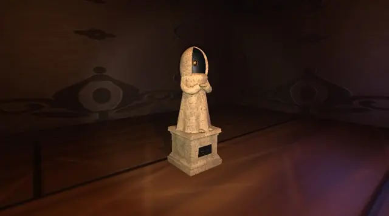

# The hooded monk statue

The hooded monk statue (`chi_statua`) is a stone figure of a monk on a stone plinth with a brass plate: a robe with organ-pipe folds, wide
sleeves and clasped hands, a rope belt with a knot and two tails, and a hood open at the front. Inside the hood, a dark shell holds a single
golden eye.

## What it is

- **Model.** The robe with organ-pipe folds, the wide sleeves and clasped hands, the rope belt, the hood with its dark inner shell and golden
  eye, and the plinth with its brass plate.
- **Size.** Model 0.74 x 2.11 x 0.74 m; collider 0.8 x 2.5 x 0.8 m (`PropDefs.cs`). The collider is taller than the statue.
- **Levels of detail.** Three levels: the model, then 28 % and 9 % of its triangles.
- **Not the enemy.** The [Statua](../enemies/statua.md) is an enemy of its own that moves only when nobody looks at it. No enemy script
  names this prop, and the prop does not move.

## Numbers

- **Triangles.** 11,976 at level 0, 3,351 at level 1, 1,075 at level 2. The FBX it replaced had 1,316.
- **Placements.** 993 in 500 generated floors (`-propstats`).

## Where it stands

- In the church kit's rooms (`RoomKitsChiesa.cs`): the nave, the presbytery (two), the chapel and the narthex, some of them in half of the cases.
- In the cathedral's chapel works, beside a prie-dieu (`HubChapel` in `RoomKits.Hub.cs`).
- In the garden annex (`FloorBuilder.Garden.cs`).
- As cover, with a weight of 1.2 (`RoomKitsCover.cs`).

## Standard and desert

- **Standard.** The church kit's rooms, the cathedral's chapel works, the garden annex and the cover kit.
- **Desert.** The desert's churches are dressed by the same church kit (`DesertSites.cs`, `DressNext`), so statues stand in their naves too.

## Related

- [The Statua](../enemies/statua.md): the enemy with a similar name.
- [The church](../places/church.md): the desert place with a nave and a yard.
- [The prie-dieu](chi-inginocchiatoio.md): the kneeler that stands beside it in the cathedral's chapel works.
- [The cathedral](../zones/cathedral.md): the base of the standard game, with its works.
