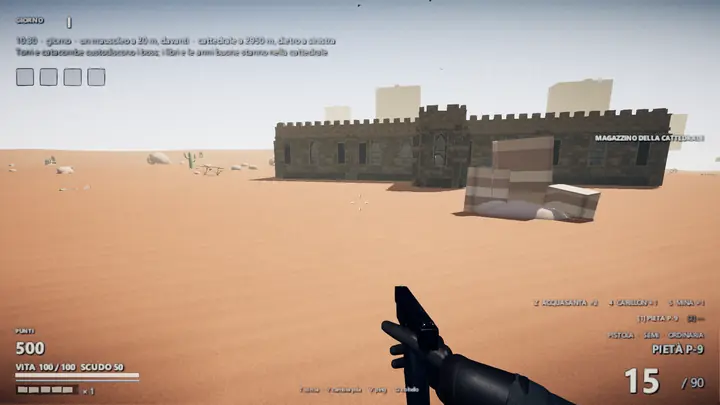

# The badlands (region)

The badlands are the region of red ground. It is broken country: many mesas, towers and catacombs, red rocks and slabs of layered
stone, and the buttes that the desert scatters on the sand are most common here.

## What it looks like

- **Mesas.** Flat-topped rises of 7 to 22 m, more of them than in the other regions and half as tall again, with eroded faces.
- **Buttes.** Four squares of 900 m in five may hold one of the rock buttes of 28 to 95 m.
- **Strata.** Steep rock of any region is painted in horizontal strata of four colours; in the badlands it is the usual scenery.
- **The ground rises most here.** The region multiplies the height of the swells by one and a half.

The badlands have towers and catacombs among their places.

## Standard and desert

Only the desert has regions. The standard game has no red ground or mesas; the nearest thing is the catacomb floors, which are underground
and have no sky. See [the catacombs](../zones/catacombs.md) for the standard levels.

## Related

- [The butte](../landmarks/butte.md): the rock that stands alone in this region.
- [The tower](../stacks/tower.md) and [the catacomb](../stacks/catacomb.md): the stacks that stand here.
- [The salt flats](salt-flats.md): the opposite of this region, flat and white.
- [The desert](../modes/desert.md): the open world as a whole.
