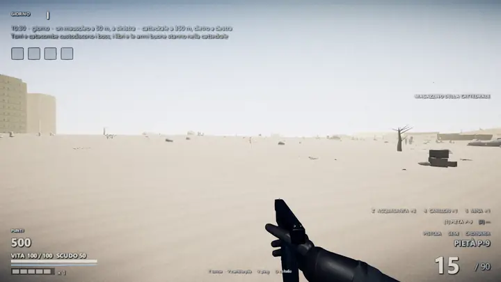

# The dead town (region)

The dead town is the region of ash-grey ground. Hotels, theatres and sanatoria stand here, falling apart, with wagons and bones on the
sand around them.

## What it looks like

- **Big buildings in ruin.** The hotels, theatres and sanatoria of this region are falling apart; only 16% of its places are whole,
  against 42% in the hamlets.
- **Wagons and bones.** Broken wagons and bones lie in the yards, and in a ruin a third of the crates and barrels are bones instead.
- **Buttes.** 18% of the squares of 900 m may hold a butte here.

## Standard and desert

Only the desert has regions. The standard game's hotel, theatre and sanatorium are branches of the floors, built as rooms with their own
themes. Here the same kinds of place are outside, in ruin. The branches are described in [the theatre](../branches/teatro-sepolto.md)
and [the sanatorium](../branches/sanatorio.md).

## Related

- [The hotel](../places/hotel.md), [the theatre](../places/theatre.md) and [the sanatorium](../places/sanatorium.md): the places of this region.
- [The tower](../stacks/tower.md): the tall stacks of the desert, some of them in this region.
- [The desert](../modes/desert.md): the open world as a whole.
