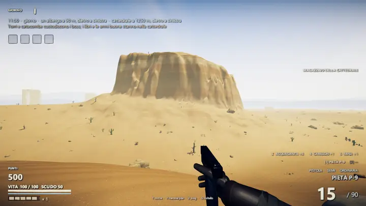

# The dunes (region)

The dunes are one of the six kinds of land of the desert. They are the region of the tallest sand: long crests that run across the wind,
one behind the other, so that every ridge has a gentle windward face and a steep slip face on the lee side.

## What it looks like

- **Crests.** The transverse dunes are 120 to 230 m from crest to crest, and some are up to 1.6 times farther apart. They are higher
  here: 9 m near the cathedral and 18 m far out. Between the crests the floor is flat.
- **Sand that smokes.** On a windy day the crests shed thin veils of sand downwind. The desert's spindrift code looks for a crest in
  front of the player every second and a half and lets at most seven smoke at a time.
- **Footprints and tracks.** The sand takes the prints of boots and the grooves of a motorbike's wheels, which the wind erases again.

The dunes are the most common region on the map: 26% of the regions are dunes. Their buttes are also common (26% of the squares of
900 m may hold one), but the buttes never stand within 250 m of the cathedral.

## Standard and desert

Only the desert has regions. The standard game's floors have themes (the church, the hotel, the theatre, the sanatorium, the
wardrobe), not regions. The region is what decides the sand colour, the height of the dunes and the kinds of place that stand on
the sand, and it changes from one kilometre-wide area to the next.

## Related

- [The desert](../modes/desert.md): how the open world plays and what each region gives.
- [The hamlets](hamlets.md): the region of the cathedral, where the first houses are.
- [The salt flats](salt-flats.md): the flat region with almost no dunes.
- [The butte](../landmarks/butte.md): the rock mesas that stand on the sand of this region too.
