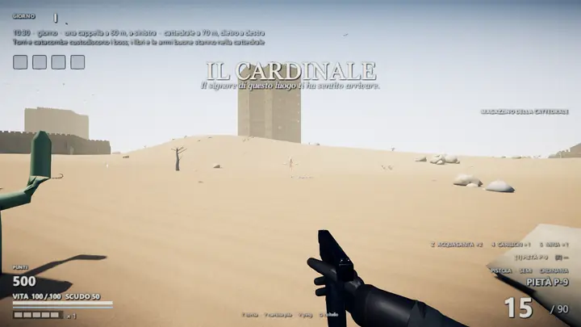

# The hamlets (region)

The hamlets are the region of dry earth with many small houses, inns, wells and windmills. The cathedral's own region is always the
hamlets, so the first look from the churchyard steps already holds houses.

## What it looks like

- **Houses and inns.** Most of the places here are small: houses and inns made of a few rooms of the floors, many of them still whole.
- **Wells and windmills.** The wells are landmarks that show from afar, and the ruined windmills turn their sails with the wind.
- **Few buttes.** Only 6% of the squares of 900 m may hold a butte here, so the horizon is mostly flat.

It is the region with the most places: 92% of its cells hold one, the highest share in the desert, and 42% of those places are whole.

## Standard and desert

Only the desert has regions, so the standard game has no hamlets. Its houses are rooms of the floors; here the houses stand on the sand,
outside, and are reached on foot or by the motorbike.

## Related

- [The cathedral](../zones/cathedral.md): the base that stands in this region.
- [The house](../places/house.md) and [the inn](../places/inn.md): the places that stand here.
- [The well](../landmarks/well.md) and [the windmill](../landmarks/windmill.md): the landmarks of this region.
- [The desert](../modes/desert.md): the open world as a whole.
