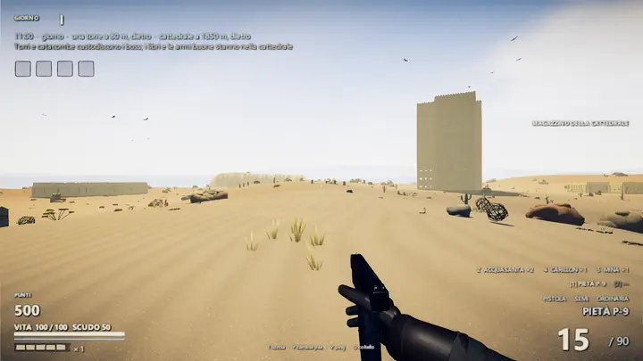

# The holy land (region)

The holy land is the region of pale chalk. It is the church country of the desert: chapels and churches stand here, with columns,
steles and obelisks, and catacombs are among its places.

## What it looks like

- **Chapels and churches.** The churches have a yard with steles, cairns and a broken column, placed by the same rule as the yards of
  every other building.
- **Obelisks and steles.** The obelisks rise 8 to 14 m above the chalk and can be seen from far away.
- **Catacombs.** A catacomb's stair goes down through a well in the sand, under a mausoleum. The holy land is one of the regions where
  they stand.
- **Buttes.** 22% of the squares of 900 m may hold a butte here.

## Standard and desert

Only the desert has regions. The standard game's chapels, churches and catacombs are rooms of the floors and of the branches; here they
are outside, under the sun, and are reached on foot or by the motorbike. The standard catacombs are described in
[the catacombs](../zones/catacombs.md).

## Related

- [The church](../places/church.md) and [the chapel](../places/chapel.md): the places that stand here.
- [The obelisk](../landmarks/obelisk.md): the tall landmark of this region.
- [The catacomb](../stacks/catacomb.md): the levels that go down under the chalk.
- [The desert](../modes/desert.md): the open world as a whole.
