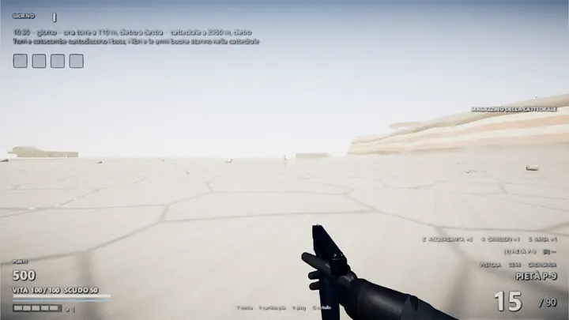

# The salt flats (region)

The salt flats are the region of white ground: flat, almost empty, with bones and white rocks.

## What it looks like

- **Flat ground.** The swells are a quarter of their usual height here, and there are almost no dunes.
- **Plates of salt.** The crust is split into plates a few metres across, with darker cracks between them.
- **Water.** About a third of the flats' interior is under a film of water: lakes a couple of hundred metres across, which reflect the sky.
  The shallow water leaves no wheel tracks and no footprints, and each step in it is a splash.
- **Few places.** 28% of its cells hold a place, the lowest share the desert document gives.
- **Buttes.** 30% of the squares of 900 m may hold a butte here: more than in the hamlets, less than in the badlands.

## Standard and desert

Only the desert has regions, and the salt flats exist only there. The standard game has no water on the ground and no flats.

## Related

- [The dunes](dunes.md) and [the badlands](badlands.md): the regions that the flats are most unlike.
- [The desert](../modes/desert.md): how the open world plays and where its things are.
- [The butte](../landmarks/butte.md): the rock that stands on the flats when a square holds one.
