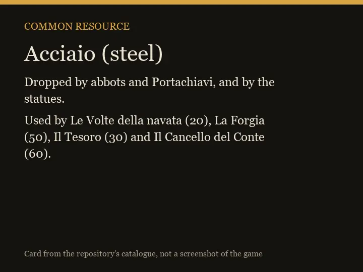

# Acciaio

Acciaio (*steel*) is a common resource: keys, needles and chains. It builds the gates, the forge and the bells of the cathedral.

## Where it comes from

- **Drops.** Abbots and the Portachiavi drop steel; statues drop three to five steel or bones with a 75% chance.
- **Amounts.** They grow by 15% for each branch.

## Where it is spent

- **Works.** The [Cancello del Conte](../works/il-cancello-del-conte.md) needs 60 steel, the [Vetrata del Direttore](../works/la-vetrata-del-direttore.md) 20,
  and the [Forgia](../works/la-forgia.md) and the bells use it too.

## Standard and desert

- **Standard.** Steel comes from the catacomb floors and is spent in the cathedral.
- **Desert.** Enemies' drops go to the store, the same as in the standard game. Abbots walk the desert.

## Related

- [Ossa](ossa.md) and [Legno](legno.md): the other common resources.
- [The abbot](../enemies/abbot.md): one of the enemies that drops it.
- [The Portachiavi](../enemies/portachiavi.md): the enemy that drops steel too.
