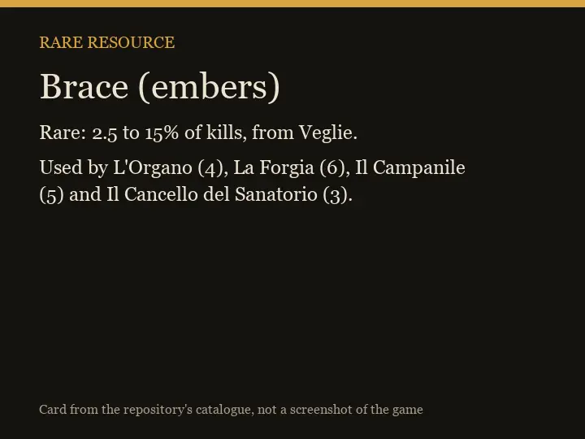

# Brace

Brace (*embers*) is a rare resource: the fire that stays in the Veglie. It lights the forge and the organ pipes.

## Where it comes from

- **Drops.** The [Veglia](../enemies/veglia.md) drops embers as its rare resource, from 2.5% to 15% of its kills.

## Where it is spent

- **Works.** The [Cappella delle Mani](../works/la-cappella-delle-mani.md) needs four embers, and the [Forgia](../works/la-forgia.md) and the organ use them.

## Standard and desert

- **Standard.** Veglie live on the catacomb floors, so embers come from there.
- **Desert.** The desert draws no Veglie, so its walkers do not give embers. The desert's rare drops are blood, hearts and the boss trophies.

## Related

- [The Veglia](../enemies/veglia.md): the enemy that drops embers.
- [Cuori](cuori.md) and [Sangue](sangue.md): the other rare resources.
- [The Cappella delle Mani](../works/la-cappella-delle-mani.md): the work that needs them.
