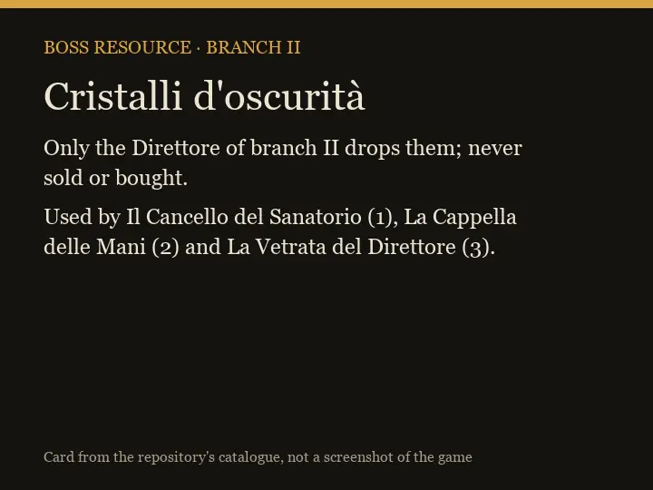

# Cristalli d'oscurità

Cristalli d'oscurità (*darkness crystals*) is a boss resource, steeped in the dark of the buried theatre. Only the Direttore of the second
branch carries them, and they are never sold or bought.

## Where it comes from

- **Trophy.** The Direttore leaves three the first time and two after, when its wave is cleared.

## Where it is spent

- **Works.** The [Cancello del Sanatorio](../works/il-cancello-del-sanatorio.md) costs one, the [Cappella delle Mani](../works/la-cappella-delle-mani.md)
  two, and the [Vetrata del Direttore](../works/la-vetrata-del-direttore.md) three.

## Standard and desert

- **Standard.** They come from the Direttore of the Teatro sepolto.
- **Desert.** The Direttore is one of the four desert bosses; its trophy goes to the store, see [the lord of the place](../enemies/signore-del-luogo.md).

## Related

- [The Direttore](../enemies/direttore.md): the boss that drops them.
- [The Teatro sepolto](../branches/teatro-sepolto.md): the second branch.
- [Reliquie](reliquie.md) and [Cristalli di fede](cristalli-di-fede.md): the other boss resources.
