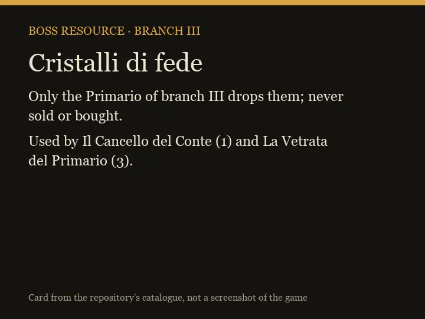

# Cristalli di fede

Cristalli di fede (*faith crystals*) is a boss resource: the prayers of the sick, crystallised. Only the Primario of the third branch keeps
them, and they are never sold or bought.

## Where it comes from

- **Trophy.** The Primario leaves three the first time and two after, when its wave is cleared.

## Where it is spent

- **Works.** The [Cancello del Conte](../works/il-cancello-del-conte.md) costs one, and the [Vetrata del Primario](../works/la-vetrata-del-primario.md)
  three.

## Standard and desert

- **Standard.** They come from the Primario of the Sanatorio.
- **Desert.** The Primario is one of the four desert bosses; its trophy goes to the store, see [the lord of the place](../enemies/signore-del-luogo.md).

## Related

- [The Primario](../enemies/primario.md): the boss that drops them.
- [The Sanatorio](../branches/sanatorio.md): the third branch.
- [Reliquie](reliquie.md) and [Gemme](gemme.md): the other boss resources.
