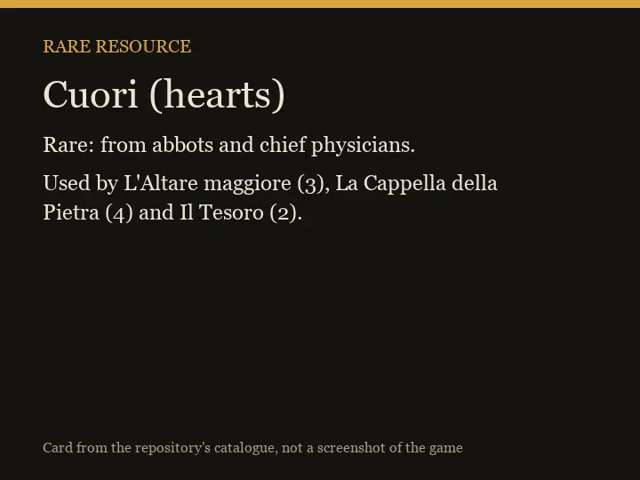

# Cuori

Cuori (*hearts*) is a rare resource: hearts that still beat, which the altars want.

## Where it comes from

- **Drops.** Abbots and chief physicians drop hearts, at 2.5% to 15% of their kills.

## Where it is spent

- **Works.** The [Altare maggiore](../works/laltare-maggiore.md) needs three hearts, and the [Cappella della Pietra](../works/la-cappella-della-pietra.md) four.

## Standard and desert

- **Standard.** Hearts come from the catacomb floors and are spent in the cathedral.
- **Desert.** Abbots and the Primario walk or stand in the desert, so the drops reach the store there too.

## Related

- [The abbot](../enemies/abbot.md) and [the Primario](../enemies/primario.md): the enemies that drop hearts.
- [Brace](brace.md) and [Sangue](sangue.md): the other rare resources.
- [The Altare maggiore](../works/laltare-maggiore.md): the work that needs them.
