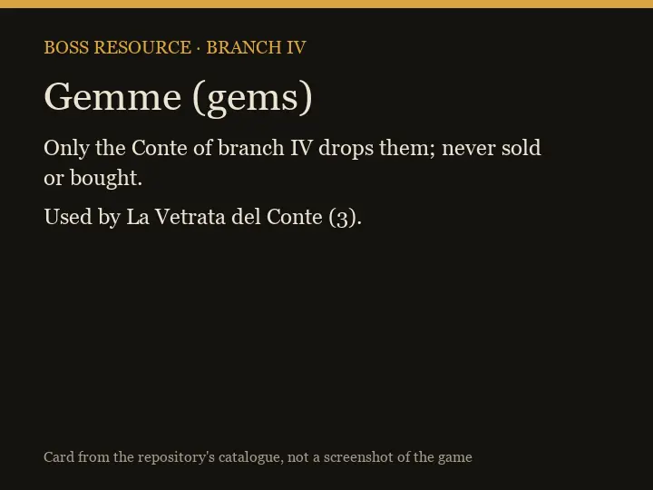

# Gemme

Gemme (*gems*) is a boss resource: the treasure of the Conte, at the bottom of his Guardaroba. Only the Conte carries them, and they are never
sold or bought.

## Where it comes from

- **Trophy.** The Conte leaves three the first time and two after, when its wave is cleared.

## Where it is spent

- **Works.** The [Vetrata del Conte](../works/la-vetrata-del-conte.md) needs three gems and five blood; that window makes the perk books cost 40% less.

## Standard and desert

- **Standard.** They come from the Conte of the [Guardaroba](../branches/guardaroba.md).
- **Desert.** The Conte is one of the four desert bosses, the Cardinale in the Guardaroba's colours; its trophy goes to the store, see
  [the lord of the place](../enemies/signore-del-luogo.md).

## Related

- [The Conte](../enemies/conte.md): the boss that drops them.
- [The Guardaroba](../branches/guardaroba.md): the fourth branch.
- [Reliquie](reliquie.md) and [Cristalli di fede](cristalli-di-fede.md): the other boss resources.
