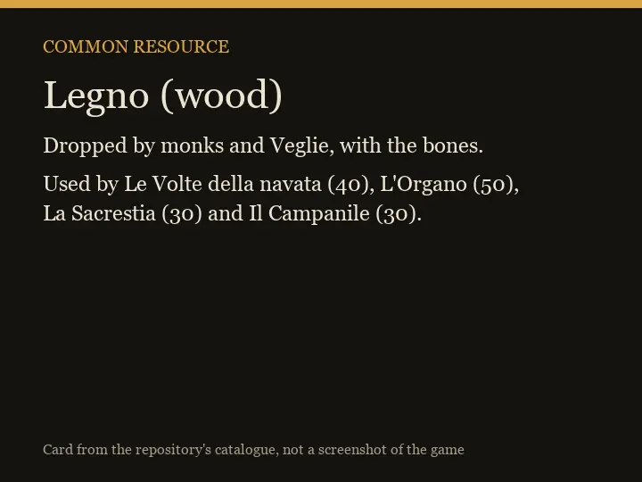

# Legno

Legno (*wood*) is a common resource: staves, rosaries and splinters of pews, the beams, the organ and the confessionals of the cathedral.

## Where it comes from

- **Drops.** Monks and Veglie drop wood as well as bones; a monk drops one or two with a 22% chance.
- **Amounts.** They grow by 15% for each branch.

## Where it is spent

- **Works.** The [Altare maggiore](../works/laltare-maggiore.md) needs 20 wood, the [Cappella delle Mani](../works/la-cappella-delle-mani.md) 40,
  and the [Vetrata del Cardinale](../works/la-vetrata-del-cardinale.md) 20.

## Standard and desert

- **Standard.** Wood comes from the catacomb floors and is spent in the cathedral.
- **Desert.** Enemies' drops go to the store, the same as in the standard game.

## Related

- [Ossa](ossa.md) and [Acciaio](acciaio.md): the other common resources.
- [The cathedral](../zones/cathedral.md): the works that use them.
