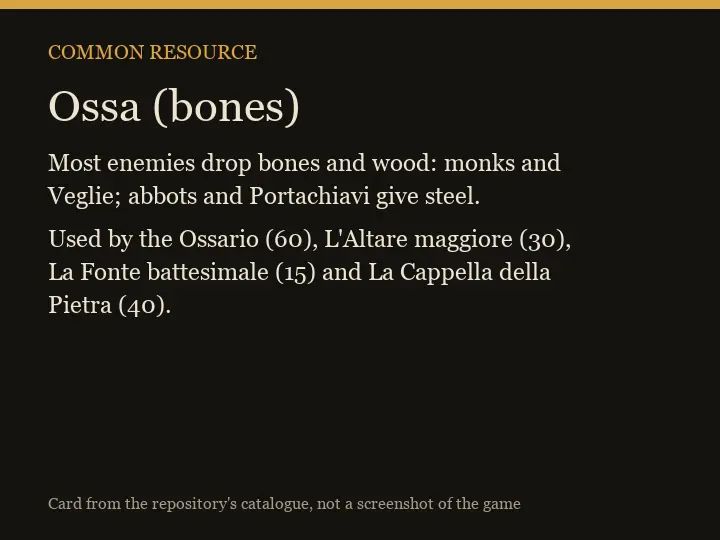

# Ossa

Ossa (*bones*) is a common resource, the bones of friars and pilgrims: the lime of the vaults and of the ossuary. It is the most used of the
common resources in the cathedral's works.

## Where it comes from

- **Drops.** Monks and Veglie drop bones or wood; a monk drops one or two with a 22% chance. Statues drop three to five steel or bones
  with a 75% chance.
- **Amounts.** They grow by 15% for each branch.

## Where it is spent

- **Works.** The [Fonte battesimale](../works/la-fonte-battesimale.md) needs 15 bones, the [Altare maggiore](../works/laltare-maggiore.md) 30,
  the [Cappella della Pietra](../works/la-cappella-della-pietra.md) 40, and the [Vetrata del Primario](../works/la-vetrata-del-primario.md) 20.

## Standard and desert

- **Standard.** Bones come from the catacomb floors and are spent in the cathedral's works.
- **Desert.** The enemies' drops go to the store, so the bones reach the cathedral in the same way; the desert's walkers include monks, which drop them.

## Related

- [Legno](legno.md) and [Acciaio](acciaio.md): the other common resources.
- [Resources](../systems/points-and-oboli.md): the points and the oboli.
- [The cathedral](../zones/cathedral.md): the works that use them.
