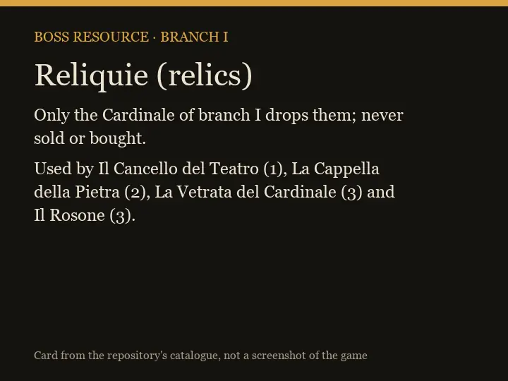

# Reliquie

Reliquie (*relics*) is a boss resource: the relics of the Cardinale, lord of the Ossario. Only the boss of its branch drops them, and they are
never sold or bought.

## Where it comes from

- **Trophy.** The Cardinale of the first branch leaves three the first time and two after; the trophy is put in the store when the wave is cleared.

## Where it is spent

- **Works.** The [Cancello del Teatro](../works/il-cancello-del-teatro.md) costs one, the [Cappella della Pietra](../works/la-cappella-della-pietra.md)
  two, and the [Vetrata del Cardinale](../works/la-vetrata-del-cardinale.md) three.

## Standard and desert

- **Standard.** The relics come from the Cardinale of the Ossario, the first branch.
- **Desert.** The Cardinale is one of the desert's four bosses; its trophy goes to the store, see [the lord of the place](../enemies/signore-del-luogo.md).

## Related

- [The Cardinale](../enemies/cardinale.md): the boss that drops them.
- [The Ossario](../branches/ossario.md): the first branch.
- [Cristalli d'oscurità](cristalli-d-oscurita.md), [Cristalli di fede](cristalli-di-fede.md) and [Gemme](gemme.md): the other boss resources.
