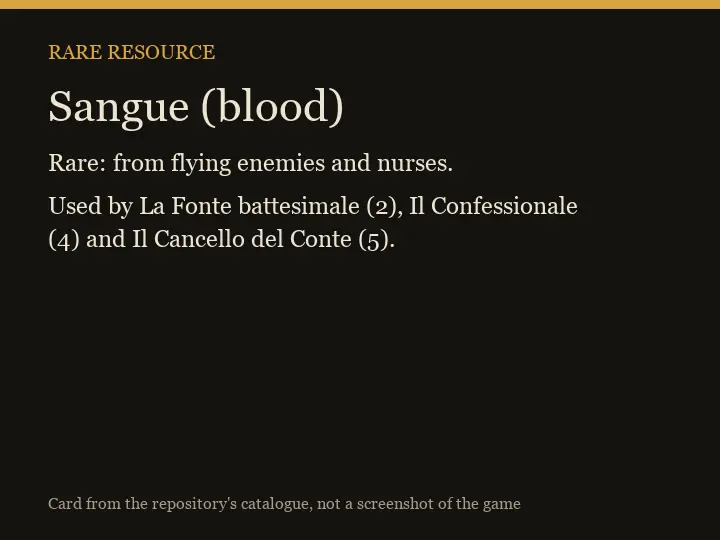

# Sangue

Sangue (*blood*) is a rare resource in phials: the water of the baptismal font and the ink of the vows.

## Where it comes from

- **Drops.** Flying things (the [flying eye](../enemies/flying-eye.md) and the [Medusa](../enemies/medusa.md)) and the nurses drop blood,
  at 2.5% to 15% of their kills.

## Where it is spent

- **Works.** The [Fonte battesimale](../works/la-fonte-battesimale.md) needs two, the [Cancello del Conte](../works/il-cancello-del-conte.md) five,
  and the [Vetrata del Conte](../works/la-vetrata-del-conte.md) five.

## Standard and desert

- **Standard.** Blood comes from the catacomb floors.
- **Desert.** The flying eye flies there only at night and the Medusa is not in the desert, so the flying eye is the source at night; the
  nurses walk the sanatorium rooms of the desert.

## Related

- [The flying eye](../enemies/flying-eye.md): a source of blood.
- [The Infermiere](../enemies/infermiere.md): the nurses that drop it.
- [Brace](brace.md) and [Cuori](cuori.md): the other rare resources.
