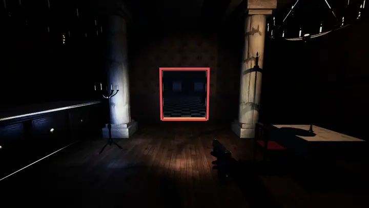

# Arena (Candela)

The arena is the room of the candle. Its door frame is the colour of fire, and inside stand a candle, a few stone columns and benches
for cover where the room has space.

## What it holds

- **The candle.** In the candle cycle you light it with `F`. Lighting it seals the room with steel shutters over every exit, and a
  round begins: the enemies come in, always aggressive, more numerous and faster each round. When the round is over the shutters rise,
  and the reward is 100 points plus 20 per round, the shield refilled and a quarter of the ammunition.
- **Columns and benches** for cover.
- **Size.** Between 71 and 310 m² and one to four doors, with the figures marked as not verified in the source.

In the wave cycle the candles are furniture: they are not lit and are not objectives. Two arenas are still placed, as decoration.

## Standard and desert

Only the standard game has room roles. The rounds are the candle cycle's; the desert has no round, no candle and no wave. See
[the desert](../modes/desert.md).

## Related

- [The candle cycle](../cycles/candle-cycle.md): the legacy cycle where the candle is lit.
- [The wave cycle](../cycles/wave-cycle.md): the default cycle, where the arena is decoration.
- [Shutters](../gates/shutter.md): the steel shutters that seal the room.
