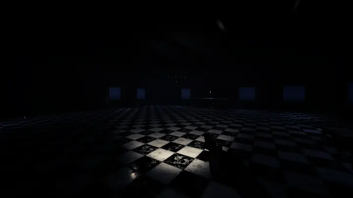

# Boss room (Boss)

The boss room has a crimson door frame. It holds the exit lift and the guardian of the floor.

## What it holds

- **The exit lift**, which opens when three waves are cleared. In the catacombs it is the gate that leads on to the next level, or up
  when it is the third level of a branch (see [the boss level](../levels/boss-level.md)).
- **The guardian.** An abbot, or in the themed floors the [Direttore](../enemies/direttore.md) of the theatre or the
  [Primario](../enemies/primario.md) of the sanatorium. The guardian has twice the hit points on floors 1 and 2, and two and a half times
  from floor 3 on.

## Standard and desert

Only the standard game has room roles. The desert's bosses stand in the top hall of its stacks; see [the desert](../modes/desert.md)
and [the lord of the place](../enemies/signore-del-luogo.md).

## Related

- [The boss level](../levels/boss-level.md): the third level, where the branch's boss waits.
- [The shutter](../gates/shutter.md): the steel shutter that closes the exit until three waves are cleared.
- [The wave cycle](../cycles/wave-cycle.md): the waves that open the exit.
