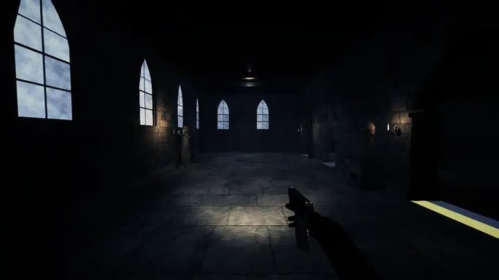

# Guard room (Guardia)

The guard room has a steel door frame. One or two guards patrol it, and they patrol only their own room until they notice you.

## What it holds

- **One or two guards**, the floor's usual types. Until they notice you they stay in the room.
- **Stealth.** In the candle cycle the guards notice you by light, noise and the distance from which you are seen, and the knife can take
  them down from behind. The wave cycle has no stealth: there is no alert and no takedown, and the guards are the ordinary enemies of
  the floor.
- **On the first floor** the rooms attached to the start are empty, so the guard rooms are never the first thing you meet.

## Standard and desert

Only the standard game has room roles. The desert has no stealth at all: its enemies rest until you come within 30 metres, and then they
hunt together. See [the desert](../modes/desert.md).

## Related

- [The start room](start-room.md): the room the guards are kept away from on the first floor.
- [The candle cycle](../cycles/candle-cycle.md): the legacy cycle that has the stealth.
- [Monk](../enemies/monk.md): the enemy that the themed guards of the theatre and the sanatorium are built on.
