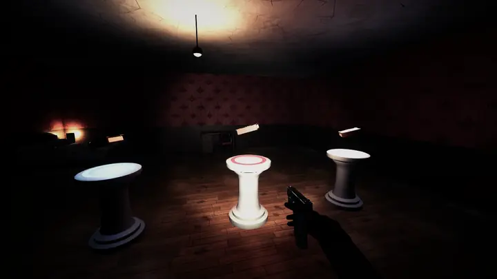

# Library room (Biblioteca)

The library room has a violet door frame. Three stone lecterns stand in a row, and on each a magic book floats and turns, with a seal in
its perk's colour.

## What it holds

- **Three perk books.** You buy one with `F`; the other two close again. Each book is one perk, and there are eight in all.
- **Four slots and four prices.** A book costs more with each perk you already hold: 2000, 2500, 3000 and 4000 points. With all four slots
  full the library offers nothing.
- **Only what matters in the mode.** In the wave cycle the library does not offer Velo or Passi di cenere, since they only matter for
  stealth.

The eight perks are described on their own pages, starting with [Pelle di pietra](../perks/pelle-di-pietra.md).

## Standard and desert

Only the standard game has room roles. The desert has the same kind of library as a work of the cathedral, the
[Library of Vows](../works/biblioteca-dei-voti.md), with the same four prices, and it is built with resources. See
[the desert](../modes/desert.md).

## Related

- [Perks](../perks/velo.md): the perk the stealth books hide.
- [The wave cycle](../cycles/wave-cycle.md): the mode that leaves out the stealth perks.
- [Shop room](shop-room.md): where the points are spent on weapons.
