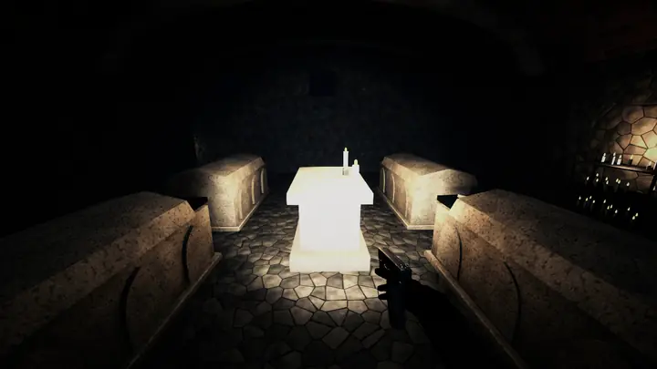

# Secret room (Segreta)

The secret room has a turquoise door frame and is entered only through a [low passage](../gates/low-passage.md): you crouch, with `C`
or Ctrl, and crawl in. Enemies do not reach it.

## What it holds

- **The Consacrazione altar.** The Pack-a-Punch: for 3000 points it consecrates the weapon in your hands, once per weapon, with
  more damage and more ammunition. See [the altar](../works/altare-della-consacrazione.md).
- **A grimoire.** The tower page also places a secret book room with a 19-node grimoire on each floor; see
  [the grimoires](../grimoires/witchcraft.md) and [the spells](../spells/fiamma-sacrilega.md).
- **Its place on the map.** The room appears on the map only after you have entered it.

The room exists only in the candle cycle. The wave cycle has no secret room, so its altar is placed in another room.

## Standard and desert

Only the standard game has room roles. The desert has the altar as a work of its cathedral, so the secret room is not needed to find it
there; see [the desert](../modes/desert.md).

## Related

- [The candle cycle](../cycles/candle-cycle.md): the only cycle with a secret room.
- [The library room](library-room.md): the other room that sells upgrades.
- [Glass eyes](../collectibles/glass-eye.md): a hidden hunt of the floors, with its own page.
