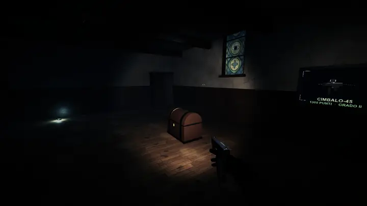

# Shop room (Negozio)

The shop room has a gold door frame. It is where you spend points on weapons, and where the mystery chest waits.

## What it holds

- **Two weapons on the wall.** You buy one with `F`, as with any wall weapon of the floor.
- **The Scrigno** (mystery chest). For 950 points its eyelids open and a weapon of one of the five grades rises out of it, more slowly
  as it rises. It stops on one at random; the higher grades weigh more the deeper you are, and it never offers the starting pistol or a
  weapon you already have. You have nine seconds to take it with `F`, or the points are lost.

## Standard and desert

Only the standard game has room roles. The desert sells its weapons in one armoury in the cathedral, at twice the standard price, and
its points come from the sand; see [the armoury](../zones/cathedral.md#standard-and-desert) and [the desert](../modes/desert.md).

## Related

- [Weapon grades](../grades/grade-1.md): the five grades the chest draws from.
- [Weapons](../weapons/pieta-p9.md): the 28 models in the walls and the chest.
- [Points](../pickups/points.md): what the chest costs.
