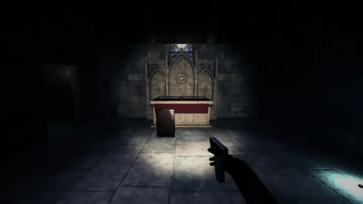

# Start room (Partenza)

Every floor begins in a start room. Its door frame is green, so you know the role before you enter it.

## What it holds

- **The arrival.** The lift you came up or down by: in the catacombs, the stone landing with the steps you came down, closed by a
  [portcullis](../gates/portcullis.md).
- **A modest weapon** on the wall.
- **No guards in the rooms next to it** on the first floor: the rooms attached to the start are empty there.

In the wave cycle the arrival lift is closed by a [steel shutter](../gates/shutter.md), but the start itself is not.

## Standard and desert

Only the standard game has room roles. The desert begins at the churchyard of the cathedral, with no room role of this kind; its
places have their own rooms, described in [the desert](../modes/desert.md).

## Related

- [The first level of a branch](../levels/first-level.md): the floor a start room opens.
- [The guard room](guard-room.md): the room the start leads to.
- [The room grid](../zones/catacombs.md): how the rooms of a floor are placed.
