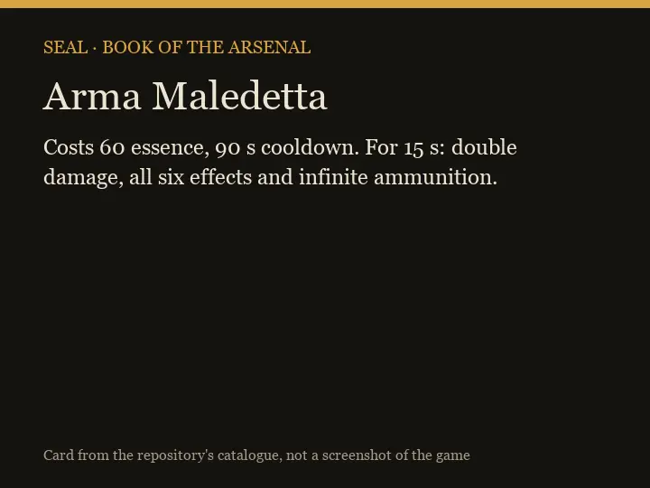

# Arma Maledetta

Arma Maledetta (*cursed weapon*) is the last seal of the Book of the Arsenal. The hand grips the barrel from below and the weapon shudders
while black fire with red cracks climbs it.

## Numbers

- **Cost.** 60 essence.
- **Cooldown.** 90 seconds.
- **Duration.** 15 seconds: double damage, all six seals at once, and infinite ammunition.

## Standard and desert

- **Standard.** It is the top node of the [Book of the Arsenal](../grimoires/arsenal.md).
- **Desert.** The desert doc describes no seals or books.

## Related

- [The Book of the Arsenal](../grimoires/arsenal.md): the book this seal belongs to.
- [Danni Critici](danni-critici.md): the first seal.
- [Essenza Maledetta](../spells/essenza-maledetta.md): the supreme spell of the other book.
