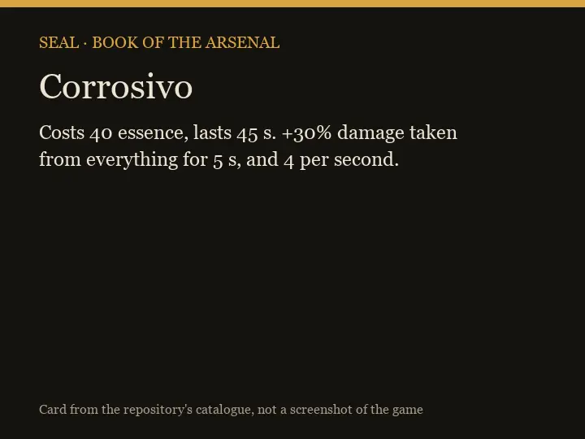

# Corrosivo

Corrosivo (*corrosive*) is traced with the cupped palm under the receiver, which fills with green ichor; the acid climbs the flanks from the cup
and drips from the underside while the hand slides under the barrel.

## Numbers

- **Cost.** 40 essence, for 45 seconds.
- **Effect.** For five seconds the target takes 30% more damage from every source, and it takes 4 damage a second.

## Standard and desert

- **Standard.** It is one of the six inner seals of the [Book of the Arsenal](../grimoires/arsenal.md).
- **Desert.** The desert doc describes no seals or books.

## Related

- [The Book of the Arsenal](../grimoires/arsenal.md): the book this seal belongs to.
- [Gelido](gelido.md): the seal that slows and freezes.
- [Essence](../pickups/essence.md): the resource it spends.
