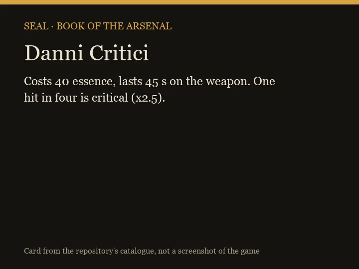

# Danni Critici

Danni Critici (*critical damage*) is traced on the weapon with the index finger: it stabs the metal three times, under the receiver, the
middle and the barrel, and each stab lights a red crack that climbs the flank before the whole weapon beats with red.

## Numbers

- **Cost.** 40 essence, for 45 seconds.
- **Effect.** One hit in four is critical, for two and a half times the damage.

## Standard and desert

- **Standard.** It is one of the six inner seals of the [Book of the Arsenal](../grimoires/arsenal.md), traced on the weapon in your hand.
- **Desert.** The desert doc describes no seals or books.

## Related

- [The Book of the Arsenal](../grimoires/arsenal.md): the book this seal belongs to.
- [Arma Maledetta](arma-maledetta.md): the supreme seal of the book.
- [Essence](../pickups/essence.md): the resource it spends.
