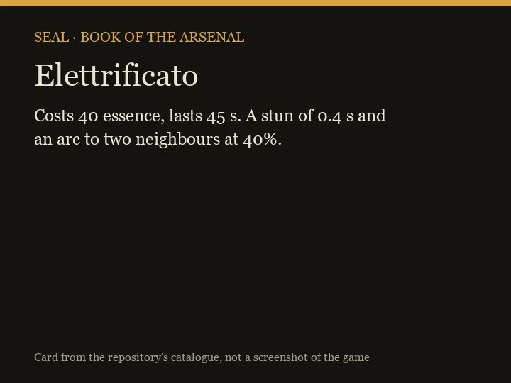

# Elettrificato

Elettrificato (*electrified*) is traced with the hand gripping the magazine and the fingers splayed with arcs; the base is slapped up, and
veins of current climb the weapon from the magazine.

## Numbers

- **Cost.** 40 essence, for 45 seconds.
- **Effect.** A stun of 0.4 seconds on the target, and an arc to two neighbours at 40% of the damage.

## Standard and desert

- **Standard.** It is one of the six inner seals of the [Book of the Arsenal](../grimoires/arsenal.md).
- **Desert.** The desert doc describes no seals or books.

## Related

- [The Book of the Arsenal](../grimoires/arsenal.md): the book this seal belongs to.
- [Gelido](gelido.md): the seal that slows and freezes.
- [Essence](../pickups/essence.md): the resource it spends.
